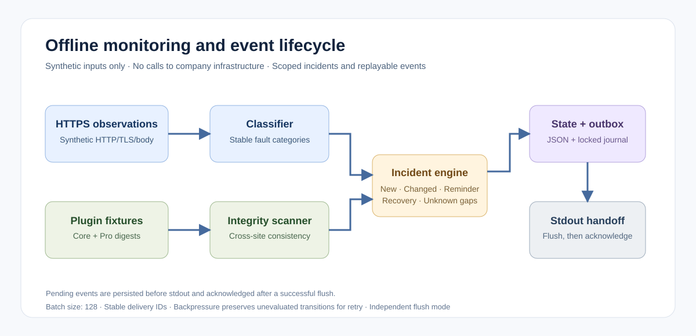

# Multi-Site Infrastructure Monitoring & Automation

**Operational problem:** Repeated website checks are only useful if they distinguish new incidents, ongoing failures, and recoveries instead of repeatedly sending the same alert.

**Engineering response:** A stateful PHP monitoring demonstration, with incident transitions, retryable reporting, and WordPress/Elementor integrity checks. Start with [what you can actually run](#what-you-can-actually-run), then [quick start](#quick-start).

**Scope:** Independently written synthetic portfolio implementation informed by real troubleshooting work; it does not monitor employer systems.

**A real operational engineering problem, demonstrated with an independently written, reproducible PHP application.**

While supporting California Machinery Movers, I investigated recurring WordPress failures, addressed Elementor-related compatibility problems across 31 installations, and developed a PHP CLI monitor for a 128-domain inventory. The historical source performs HTTPS/application diagnostics, compares failures against persisted JSON incident state, and reports newly detected, changed, persistent, and recovered conditions. A separate integrity mode inspects Elementor installations and compares SHA-256 directory fingerprints.

**The engineering challenge:** turn periodic checks into actionable *changes in state* rather than sending the same outage report on every run.

> **Provenance and confidentiality:** This public package is a **new, synthetic educational implementation** of those engineering concepts—not the original deployed code, a production backup, a copy of employer-owned source, or an active monitor of any real company websites. It uses reserved example hostnames and invented plugin fixtures. See [provenance](docs/provenance-and-limitations.md) and [release safeguards](docs/security-and-release.md).

## Verified engineering release

The finalized **CMM-CI-02** archive passed **30/30 external certification gates**. Its offline regression suite passed **334/334 tests** in each of PHP **8.2.32**, **8.3.6**, and **8.4.24**. Xdebug in-process line coverage was **89.6%**, **89.6%**, and **89.4%**, respectively; the coverage measurement excludes CLI subprocesses. PHPStan passed at the repository's configured **level 1** on all three runtimes, using a genuine Composer-resolved dependency lockfile.

Those results come from the external certification evidence, **not from hosted GitHub Actions**. The repository's `ci.yml` workflow should be inspected separately after publication. See [validation and reproducibility](docs/validation.md) for scope and provenance.

## What you can actually run

| Component | Verified demonstration behavior | Primary entry point |
| --- | --- | --- |
| HTTPS classifier | Transport, TLS, timeout, HTTP, redirect, conservative CSS/HTML visibility, and structural application-error classification | [`src/Monitoring/Classifier.php`](src/Monitoring/Classifier.php), [`HtmlFaultDetector.php`](src/Monitoring/HtmlFaultDetector.php), [`InlineVisibility.php`](src/Monitoring/InlineVisibility.php) |
| Stateful incident engine | New, changed, reminder, recovery, retirement, verification-gap escalation, and suppression | [`src/IncidentState/StateEngine.php`](src/IncidentState/StateEngine.php) |
| Retryable event outbox | Bounded delivery batches, stable event IDs, backpressure, replay and acknowledgment | [`src/IncidentState/EventOutbox.php`](src/IncidentState/EventOutbox.php) |
| Crash-conscious persistence | Locking, file/directory sync and atomic JSON state replacement | [`src/IncidentState/StateStore.php`](src/IncidentState/StateStore.php) |
| WordPress diagnostics | Synthetic Elementor presence, metadata, lock, and cross-site SHA-256 comparison | [`src/Integrity/IntegrityScanner.php`](src/Integrity/IntegrityScanner.php) |
| Offline CLI | JSON output, deterministic timestamps, no network requests | [`bin/monitor.php`](bin/monitor.php) |
| Automated validation | Unit, filesystem, concurrency, and CLI integration scenarios | [`tests/run.php`](tests/run.php) |

## Quick start

**Requirements:** PHP 8.2 or newer for the offline application and tests; Python 3 and pinned PyYAML 6.0.3 for strict, parsed-YAML publication screening. Bash and a Unix-like environment are recommended for the demo scripts. No Composer install, database, WordPress installation, credentials, or network requests are required for the core application. Preinstall the YAML scanner dependency before running the release scan.

From the repository root (install the pinned YAML scanner dependency into a suitable Python environment first):

```bash
python3 -m pip install -r requirements-security.txt
php bin/monitor.php --help
php tests/run.php
php tools/lint.php
php tools/validate_svg.php
php tools/publication_scan.php --release .
php tools/verify_manifest.php .
sha256sum -c MANIFEST.sha256
```

For PHPStan static analysis (requires Composer; the certified release includes the genuine solver-generated `composer.lock`):

```bash
composer install
composer analyse
```

Run a synthetic 500 error:

```bash
php bin/monitor.php uptime \
  --config config/demo.json \
  --responses examples/responses/failure.json \
  --state var/demo-uptime-state.json \
  --at 2026-01-01T00:00:00Z
```

This emits a `new` event with a persistent `id` on the first run, no event for an unchanged incident before the reminder deadline, and a `reminder` event after six hours. To experience a full deterministic sequence without modifying tracked files:

```bash
bash examples/run-lifecycle.sh
```

Run a clean synthetic WordPress/Elementor integrity scan:

```bash
php bin/monitor.php integrity \
  --config config/demo.json \
  --state var/demo-integrity-state.json \
  --at 2026-01-01T00:00:00Z
```

Then demonstrate divergence and recovery in a temporary copy of the fixtures:

```bash
bash examples/run-integrity-demo.sh
```

To replay pending events without reading or evaluating any new fixture, run:

```bash
php bin/monitor.php flush --mode uptime --state var/demo-uptime-state.json
```

To migrate a *synthetic copy* of a pre-outbox legacy state, explicitly acknowledge that historical undelivered alerts cannot be reconstructed and retain the automatic backup:

```bash
php tools/migrate_legacy_state.php --state /path/to/synthetic-legacy-copy.json --acknowledge-unrecoverable-historical-alerts
```

The current schema rejects state files whose outbox has disappeared. Never apply migrations to employer infrastructure without separate authorization and a recovery plan.

The scripts create disposable state and fixtures under your system's temporary directory. Sample event IDs are random and will differ between executions, even when timestamps and simulated inputs are identical. JSON `events` contain `new`, `changed`, `reminder`, `recovered`, `retired`, `verification_gap`, `verification_gap_reminder`, `verification_restored`, or `verification_retired`; `active_issues` contains confirmed incidents. `unverified_targets` lists unknown observations (including same-host redirects and HTTP 206); sustained unknown states emit verification-gap events after configurable thresholds and a resolution/retirement event when verification resumes or the target leaves the inventory, and `monitoring_gap_exceeded` reports missed expected run intervals detected at the next execution. Events are replayed from the persistent outbox if the stdout handoff fails. Exit status **0** means an offline scan or flush completed (even if a synthetic site is unhealthy). **1** means a runtime/input/output failure. **2** means the outbox backlog was drained but **new monitoring was deferred** by safe backpressure; rerun the monitor to evaluate the unchanged observation. A backpressure result has `monitoring_deferred: true`, never a false scan success. Event IDs are stable across at-least-once replays, so consumers can deduplicate. See [sample output](examples/sample-output/).

## Architecture at a glance

1. **Input boundary:** `config/demo.json` restricts target names to reserved example domains and fixture trees, while JSON response fixtures supply deterministic observations. Persisted state, configuration, and response fixtures reject duplicate JSON object members before their values can be overwritten during decoding. The CLI never performs HTTP requests.
2. **Classification:** response metadata and bounded, approximated visitor-visible body text become machine-readable fault codes. Malformed HTML is recorded as `unverified_html` for the affected target, without interrupting sibling checks. A 200 response containing a recognizable WordPress failure region is unhealthy. The fault detector scans structural text regions, excludes instructional examples, and does not allow a guide in one region to suppress a separate failure. Document declarations are excluded from content checks. Both classification paths share the complete HTML void-element set and an explicit non-rendered/fallback-element policy; ambiguous self-closing non-void HTML and escaped inline CSS cannot establish a healthy recovery. Normal same-host redirects and active, valid HTML meta-refresh navigation are `unverified`; default HTTP 200 handling requires meaningful visible content. **All other 2xx statuses, including 204/205, require an explicit host content policy to establish health.** A host-specific `contains` assertion gives stronger recovery evidence. No-op/empty content policies are rejected. A `json_health` policy checking a named JSON field provides deterministic positive evidence from a synthetic machine-readable endpoint without browser/CSS interpretation. Unsupported styles, external stylesheets, and CSS selectors cannot establish verified health. An unselected dropdown option cannot supply a success marker, and HTML meta refresh is `unverified_redirect`.
3. **State transition:** the engine compares confirmed observations against persisted state and checked inventory, distinguishing `recovered` from `retired`, preserving incidents on unknown observations, and escalating prolonged unknown states independently from confirmed outages. During an unknown observation, the last confirmed fault is stored as a suspended issue within `unknown_history` so a target cannot simultaneously be recorded as confirmed failed and unverified.
4. **Persistence and outbox:** schema version 2 requires an explicit outbox alongside incident history; the monitor commits state plus pending events under an exclusive lock. A batch of at most 128 pending events is emitted to stdout with stable IDs and then acknowledged; failed output is retried, and crash-induced duplicates remain possible. A shared 5-MB state limit is checked before writing, and a smaller admission budget triggers backlog draining without committing an unevaluated monitoring transition.
5. **Integrity mode:** a distinct offline mode checks invented Elementor plugin paths, strict top-level PHP metadata declaration shape, **required approved** synthetic Core/Pro directory and update-lock hashes, and cross-site SHA-256 consistency without blaming baseline-matching sites. One invalid site does not block sibling checks.



### Historical design versus this demonstration

The verified source snapshots have `probe_domain()`, `emit_changes()`, `run_uptime()`, `run_integrity()`, and `directory_hash()`. The original design includes a six-hour uptime reminder and a stated one-day integrity reminder interval. Source inspection found that the daily integrity reminder **was not actually executed** by the historical conditional; the independent implementation handles reminders per target in both modes. Other differences and evidence levels are tracked in the [engineering audit](docs/audit-and-remediation.md).

The CSS interpretation is deliberately fail-closed for unsupported rendering properties; it is **not** a full CSS layout or JavaScript engine. A page with unverifiable presentation rules is marked `unverified_html` rather than being used to close an existing outage. Positive status-code evidence without an application assertion is weaker than a dedicated health endpoint.

The public repository now intentionally **excludes live cURL transport**. The historical source used cURL; this independently written version provides reproducible classification without SSRF risk or unauthorized network requests. It is not a production network monitor.

## Engineering evidence

- [Architecture and data flow](docs/architecture.md)
- [HTTPS failure classification](docs/https-diagnostics.md)
- [Incident lifecycle and alert policy](docs/incident-lifecycle.md)
- [WordPress integrity and hashing](docs/wordpress-integrity.md)
- [Case study: operational problem to monitor design](docs/technical-case-study.md)
- [Source audit, severity, and remediations](docs/audit-and-remediation.md)
- [Test methods and validation evidence](docs/validation.md)
- [Consolidated remediation history](docs/remediation-history.md)
- [Version 15 comprehensive audit remediation (Version 16)](docs/v15-comprehensive-remediation.md)
- [Version 14 independent audit remediation (Version 15)](docs/v14-independent-audit-remediation.md)
- [Historical issue-by-issue records](docs/remediation-history.md) — older audit links and evidence are preserved there
- [Provenance, rights, and claims boundary](docs/provenance-and-limitations.md)
- [Operational deployment considerations](docs/deployment-and-operations.md)

## Scope and claims

The operational experience involved a **128-domain inventory** and **31 Elementor installations**. Those counts describe the historical source and work context, not the two synthetic fixture sites. The repo does **not** claim measured uptime increases, fewer outages, delivered email counts, labor savings, a service-level agreement, or public release rights for the employer-owned application. The original inventory, paths, cron commands, recipients, incident history, source, and private-source checksum are deliberately excluded.

**Built to demonstrate:** PHP architecture and testing (Software Engineering); HTTPS, WordPress, incident diagnostics, and reproducible support practices (IT Support); structured classification and state comparisons (Data Analytics); and repeatable issue-handling workflows (Operations Coordination).

**License:** MIT applies only to newly authored material in this public demonstration. It does not cover employer source or third-party Elementor products.

## CMM-17 architectural remediation

The current release tightens positive-health evidence, adds portable Unicode 15.1 NFC normalization, unifies incident/outbox event validation, introduces schema-safe alert history, and replaces YAML line heuristics with a fail-closed structured scanner. The additional synthetic `json_health` endpoint contract avoids relying on unverifiable external CSS. See the [CMM-17 remediation and re-audit](docs/cmm17-architectural-remediation.md) and [current validation results](docs/validation.md).
