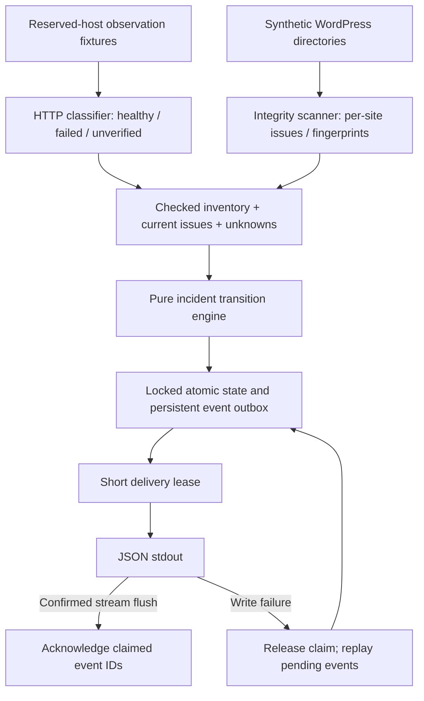

# Architecture and data flow

The public CLI is a **synthetic, offline application**, not an internet scanner. It accepts complete sets of simulated HTTPS observations or local fictional WordPress fixture directories. Uptime and integrity modes have independent configuration validation.

| Implementation | Role |
| --- | --- |
| `src/Support/Config.php` | Validates only the selected mode; reserved hostnames and locally confined fixtures |
| `src/Monitoring/Classifier.php` | Pure HTTP/transport/body classification, including unverified redirects and configurable content assertions |
| `src/IncidentState/StateEngine.php` | Tracks checked inventory, open issues, unknown results, per-target reminders, retirement and recovery |
| `src/IncidentState/EventOutbox.php` | Stages pending events, leases a delivery batch, and acknowledges **only claimed IDs** |
| `src/IncidentState/StateStore.php` | Serializes local JSON transactions with `flock`; temporary-file write, file sync, atomic rename, POSIX directory sync |
| `src/Integrity/DirectoryFingerprint.php` | SHA-256 over deterministically ordered file/directory entries; rejects symlinks |
| `src/Integrity/IntegrityScanner.php` | Site-by-site checks of fictional plugins, tokenized metadata, update-lock SHA-256, approved Core and Pro directory fingerprints, and cross-site comparisons |
| `bin/monitor.php` | Offline CLI that stages events, emits JSON, and acknowledges the stdout handoff |

## State semantics

`schema_version: 2` requires both `modes` and the `outbox` map, even before event generation. Each mode stores a checked `inventory`, `unknown` targets, currently confirmed `issues`, `last_run`, and `unknown_history` (first observed, last observed, last queued verification-gap alert, and optional suspended last confirmed issue). The two maps have disjoint keys. Each issue records `first_seen`, `last_seen` and `last_notified` (the latter denotes **notification queued for the outbox**, not confirmed delivery to a human). Removing an unhealthy target creates a `retired` event; only a verified healthy observation can create a `recovered` event. An unverified redirect or HTTP 206 suspends any last confirmed incident within unknown history without asserting recovery. Prolonged unknown periods generate separate verification-gap events after configured thresholds.

The outbox holds immutable event objects with random IDs. One run claims a batch for 120 wall-clock seconds. Concurrent runs may stage new events but cannot acknowledge a different claim's batch. A successful write and flush to stdout allows the CLI to acknowledge exactly the claimed event IDs. A failed write releases the claim and leaves events pending; a crash leaves a lease that eventually expires and permits replay on a later run. This provides **at-least-once handoff to stdout**, not exactly-once end-to-end alert delivery. A successful stdout write may be followed by a failed acknowledgment, producing a duplicate replay. Each delivered event carries its stable outbox `id`; a non-interactive consumer should deduplicate by that ID in durable downstream storage.

State transactions assume participating processes share a trusted local filesystem. Data and directory metadata are synchronized on POSIX platforms where the supported filesystem permits it, but no portable storage stack can guarantee immunity to every underlying hardware failure. Admission is limited by 10,000 pending events **and** a 3-MB serialized-state budget. The state writer rejects anything over its 5-MB readable limit before commit. When incoming transitions would saturate the outbox, the CLI drains one existing batch, returns exit 2, and does not commit those incoming transitions; the caller must rerun monitoring. A separate `flush` mode drains pending events without evaluating fresh input. A monitoring process that never runs again cannot deliver its pending events.

## Confidence and freshness

A configured full observation for each monitored target is required. `unverified_targets` and `monitoring_gap_exceeded` in CLI output communicate unknown observation and missed-interval information, respectively. These are **run-time observations**, not a watchdog capable of detecting a cron job that never starts. An independent scheduler health check would be necessary for that.

## Non-goals

The package deliberately omits live cURL transport, real WordPress plugin code, external mail delivery, production credentials, real inventory, monitoring dashboards, and remote-site probing. These choices prevent accidental production infrastructure exposure or unsupported SSRF-hardening claims.
