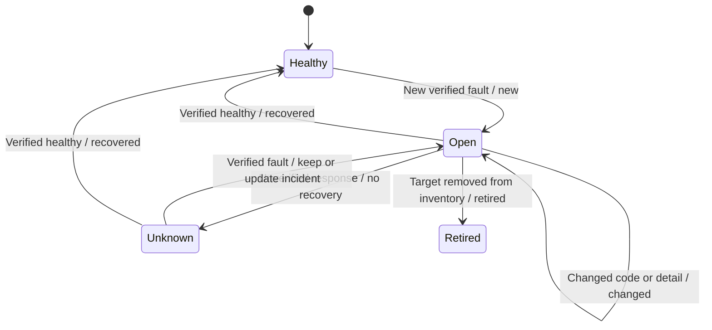

# Incident lifecycle and alert policy

Each target moves between **healthy**, **open incident**, **unknown**, and **removed from scope** based on the observation and current checked inventory. The available events are `new`, `changed`, `reminder`, `recovered`, `retired`, `verification_gap`, `verification_gap_reminder`, `verification_restored`, and `verification_retired`.



| Time UTC | Synthetic check | State change |
| --- | --- | --- |
| 00:00 | 200 healthy | None |
| 00:30 | 500 | `new` |
| 01:00 | Same 500 | Suppressed |
| 06:30 | Same 500 | `reminder` (six hours after prior queued notification) |
| 07:00 | TLS failure | `changed` |
| 07:15 | 302 `/login` | `unverified_redirect`; previous confirmed failure is suspended, not recovered |
| 07:30 | 200 healthy | `recovered` |

If the target is removed from the configured inventory at 07:30 instead, its open incident generates `retired`, **not** `recovered`. A missing configured observation remains a fatal input error. A target returning unverified redirect data or a partial HTTP 206 response is explicitly listed in `unverified_targets` and is not counted as a confirmed outage. Persistent unknown observations acquire an independent `unknown_history` clock and emit `verification_gap` after the configured threshold (default one hour), then `verification_gap_reminder` after the configured reminder interval (default six hours). They **do not** manufacture a confirmed outage or recover an existing one. A previously confirmed failure is moved into `unknown_history[target].last_confirmed_issue` for the duration of unverified observations. `issues` and `unknown_history` are mutually exclusive; a later healthy observation emits recovery for the suspended failure, while a later observed fault resumes or changes it without fabricating another `new` event. Verified observations after an escalated gap emit `verification_restored`, even if the verified observation is a confirmed fault; retirement emits `verification_retired`. A gap that never escalated closes silently. Both closure events clear the unknown clock. These notifications are outbox events and retain the same stdout delivery boundaries as incident events.

`--at` supports exact UTC timestamps. Uptime and integrity reminder thresholds are separately configured (the example uses six hours and one day), with separate clocks per target. The state engine also stores `unknown_history` for unverified-observation durations. `last_notified` in the state represents the latest event **scheduled for durable handoff**. Its name is retained for compatibility with the original initial demo schema; it is not proof that an external recipient saw an alert.

## Outbox and delivery outcomes

1. Under an exclusive local lock, classify the full inventory and append new transition events to persistent `outbox[mode].pending`.
2. Claim available events with a 120-second wall-clock lease. New events added by concurrent runs are held for the next claim.
3. Print a JSON payload containing claimed events. A failed stdout write or flush exits unsuccessfully, releases the claim, and preserves pending events.
4. After stdout succeeds, acknowledge the **claimed IDs only**. If the process crashes between stdout and acknowledgment, a later run can replay those events after lease expiration; duplicates are possible.
5. Zero events may mean a stable period **or** a concurrent run currently owns a pending delivery claim. Operators can inspect the private state and logs for outbox backlog.

The handoff guarantee ends at stdout. An external email gateway or downstream processor must independently implement acknowledgments and deduplication if its own delivery guarantees matter. Permanent inactivity of the monitor cannot trigger retries without a separate scheduled runner.

## Reliability invariants

Malformed JSON, invalid schema, incomplete persisted event records, cross-mode corruption, malformed incident timestamps, missing configured observations, or clock rollback fail closed. File locks serialize local participating runs. State writes use temporary files and atomically replace the prior state, with file and directory sync where supported. Unknown observations do not update `last_seen` for a previously open incident because they do not independently verify its continued condition. `monitoring_gap_exceeded` reports observed gaps when a new run finally executes, but cannot diagnose never-executed jobs.

## Bounded delivery, backpressure, and replay

The outbox stores immutable alert records with 32-character random `id` fields. The CLI emits **at most 128 events per delivery claim**. Successful stdout flush acknowledges only that batch; a failed or interrupted handoff retains its event IDs for at-least-once replay. Downstream consumers can deduplicate using those IDs but must not mistake stdout handoff for actual email or human acknowledgment.

The state writer enforces its 5-MB read/write limit **before atomic replacement**. The outbox imposes a smaller 3-MB serialized-state admission budget. If a new set of incidents would exceed capacity, the process **does not record those new transitions**; it emits an existing pending batch, acknowledges it, and exits **2** with `monitoring_deferred: true`. The caller must retry that synthetic observation; it must not interpret exit 2 as successful monitoring. Existing pending batches can always be drained independently:

```bash
php bin/monitor.php flush --mode uptime --state var/demo-uptime-state.json
```

This replay-only command requires no config, response fixture, or WordPress installation. Repeated calls drain a backlog in bounded batches. A concurrently held delivery claim may require retry after its 120-second lease. The repository intentionally has no external delivery service or unattended backpressure scheduler.

## Persisted history invariants (Version 8 demonstration package)

A current-format snapshot must contain a complete `inventory`, `unknown` list, `unknown_history` map and `last_run`. Every recorded incident or unknown-history target belongs to the previous inventory. The keys of `unknown_history` must equal the previous unknown list, preserving verification-gap continuity. `issues` and `unknown_history` must have disjoint target keys. An unverified target can carry `last_confirmed_issue` inside `unknown_history` so its most recent confirmed fault is retained without asserting an active failure at the current observation. State snapshots from the older, pre-verification format remain accepted only when **none** of those new fields is present. Partial current-format snapshots fail closed and require explicit review/migration; there is no silent reconstruction of missing gap history.

The persistence reader checks raw JSON array-versus-object identity before associative decoding. `modes`, `outbox`, `issues` and `unknown_history` are JSON objects (including when empty); `inventory`, `unknown` and `pending` are JSON arrays. Invalid envelopes do not overwrite the original file on failure.

**Explicit migration boundary:** Earlier Version 7 state files may have represented a recently failed target in both `issues` and `unknown_history`. Such contradictory snapshots are rejected unchanged by Version 8. This offline demonstration offers no automatic migration; a private state operator must reconcile those records under a documented plan, never delete queued alerts to force a successful read.

## Version 9 lease-skew and history validation

A bounded five-minute tolerance prevents minor backward wall-clock adjustments from invalidating an otherwise active 120-second outbox claim. Leases with impossible far-future expiry values can still be reclaimed. This protects ordinary local clock changes only; it does not create monotonic distributed leases. Historical incident code, detail, and target lengths now conform to the event-outbox schema at load time, preventing an accepted old incident from later blocking recovery events. Invalid state requires explicit repair rather than silent reset.
